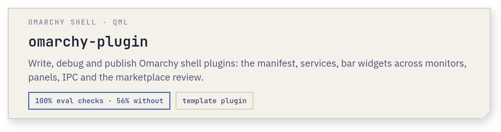
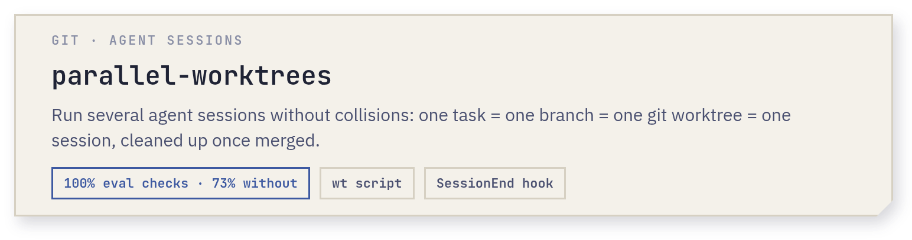
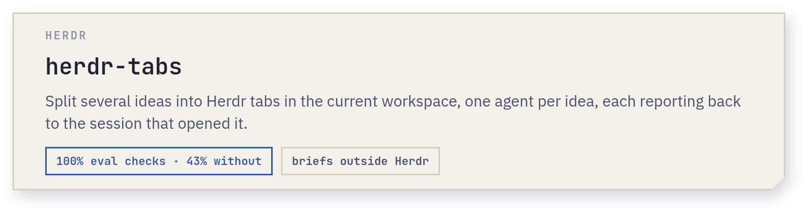
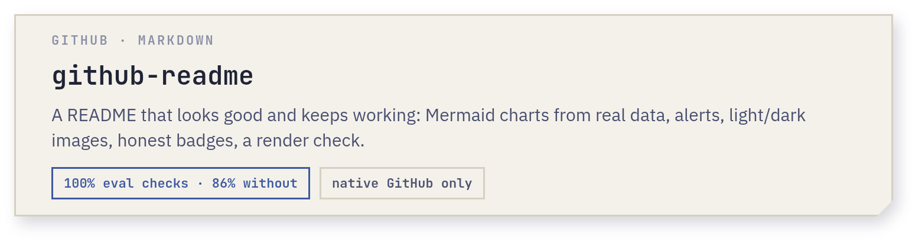

<div align="center">

<h1>agent-skills</h1>

<p>Skills for AI coding agents (Claude Code, Codex, Gemini CLI, Cursor and others
that read <a href="https://agentskills.io">Agent Skills</a>), each tested with evals.</p>

[](LICENSE)

[Skills](#skills) · [Install](#install) · [Use](#use) · [Evals](#evals)

</div>

## Skills

Click a card for details.

<details>
<summary><picture><source media="(prefers-color-scheme: dark)" srcset="assets/omarchy-plugin-dark.png"></picture></summary>

The manifest, services and bar widgets that work across several monitors, panels and the UI kit, IPC, settings, and what the plugin marketplace review asks for (no Qt text fields: text input goes through the bundled `LineEdit.qml`). It reads the installed sources first (`/usr/share/omarchy/shell/`) and treats them as the truth, so it keeps working as Omarchy changes.

[SKILL.md](skills/omarchy-plugin/SKILL.md) · `/plugin install omarchy-plugin@dan4a-skills`
</details>

<details>
<summary><picture><source media="(prefers-color-scheme: dark)" srcset="assets/parallel-worktrees-dark.png"></picture></summary>

Comes with `wt`, a script that creates task worktrees, hands a task off to a new session (in Herdr) and removes worktrees once their branch is merged, including squash merges, from a Claude Code `SessionEnd` hook. In Herdr it also closes a merged child's idle session with its workspace, and the repo's workspace after its last worktree.

[SKILL.md](skills/parallel-worktrees/SKILL.md) · `/plugin install parallel-worktrees@dan4a-skills`
</details>

<details>
<summary><picture><source media="(prefers-color-scheme: dark)" srcset="assets/herdr-tabs-dark.png"></picture></summary>

Tabs in the current workspace with names of an emoji type and a short topic (💡 idea, 🔧 task, 🔍 research), a self-contained brief for each agent, follow-ups sent to a topic's existing tab, and a 2–3 line report back to the session that opened them. Outside Herdr it writes the briefs to paste instead.

[SKILL.md](skills/herdr-tabs/SKILL.md) · `/plugin install herdr-tabs@dan4a-skills`
</details>

<details>
<summary><picture><source media="(prefers-color-scheme: dark)" srcset="assets/github-readme-dark.png"></picture></summary>

What it is, a screenshot, install and use on the first screen; only what GitHub renders natively (tables as panels, alerts, `<details>`, Mermaid diagrams and `xychart-beta` charts built from the repo's data, `<picture>` for light and dark images); badges only for real state, no live third-party widgets; and a render check with `gh api markdown` before calling it done.

[SKILL.md](skills/github-readme/SKILL.md) · `/plugin install github-readme@dan4a-skills`
</details>

<!-- Cards are rendered from assets/src/cards.html by assets/src/render.sh. -->

## Install

Any agent, with the [`skills`](https://github.com/vercel-labs/skills) CLI:

```bash
npx skills add dDan4a/agent-skills                         # pick from the list
npx skills add dDan4a/agent-skills --skill omarchy-plugin  # just this one
```

Claude Code, as a plugin marketplace:

```
/plugin marketplace add dDan4a/agent-skills
/plugin install omarchy-plugin@dan4a-skills
/plugin install parallel-worktrees@dan4a-skills
/plugin install herdr-tabs@dan4a-skills
/plugin install github-readme@dan4a-skills
```

Update an installed plugin with
`claude plugin marketplace update dan4a-skills && claude plugin update <name>@dan4a-skills`,
then `/reload-plugins`.

By hand: copy `skills/<name>/` into your agent's skills directory, for
example `~/.claude/skills/`, `~/.codex/skills/` or `~/.gemini/skills/`.

## Use

Ask for what you want; the agent loads the skill when it fits:

> Make an Omarchy bar widget that shows my GitHub notifications, with a panel listing them.

> Start a task in api to fix the login timeout, in its own worktree and session.

> Three ideas, split them into tabs: SQLite or JSON for the plugin's history, what the AUR asks for now, and the typo in notes.

> Make this README look nicer and add a chart of the benchmark.

## Evals

Share of checks passed per skill, Claude Opus 5.5, one run per eval (2026-10-17). Each skill has two bars drawn over each other: the full one is with the skill, the inner one without.

```mermaid
xychart-beta
  title "Checks passed, %: with the skill (back) and without (front)"
  x-axis ["omarchy-plugin", "parallel-worktrees", "herdr-tabs", "github-readme"]
  y-axis "%" 0 --> 100
  bar [100, 100, 100, 100]
  bar [56, 73, 21, 77]
```



| Skill | With the skill | Without |
|---|---:|---:|
| `omarchy-plugin` 0.1.5 | 100% (32/32) | 56% (18/32) |
| `parallel-worktrees` 0.1.4 | 100% (30/30) | 73% (22/30) |
| `herdr-tabs` 0.1.0 | 100% (14/14) | 21% (3/14) |
| `github-readme` 0.1.0 | 100% (22/22) | 77% (17/22) |

<details>
<summary>How the evals work and how to run them</summary>

Every skill has evals in `skills/<name>/evals/`: `evals.json` (prompts and
the checks a run must pass, in the
[skill-creator](https://github.com/anthropics/skills/tree/main/skills/skill-creator)
format) and `sandbox.sh`, which builds a throwaway home, repos or plugins for
each prompt. `scripts/run-evals` runs every prompt with and without the skill
in Claude Code, isolated from your own settings and files:

```bash
MODEL=claude-opus-5-5 scripts/run-evals parallel-worktrees /tmp/evals/iteration-1
```

Then grade the runs against the expectations, for example with skill-creator's
grader and benchmark viewer.
</details>

## License

[MIT](LICENSE)
